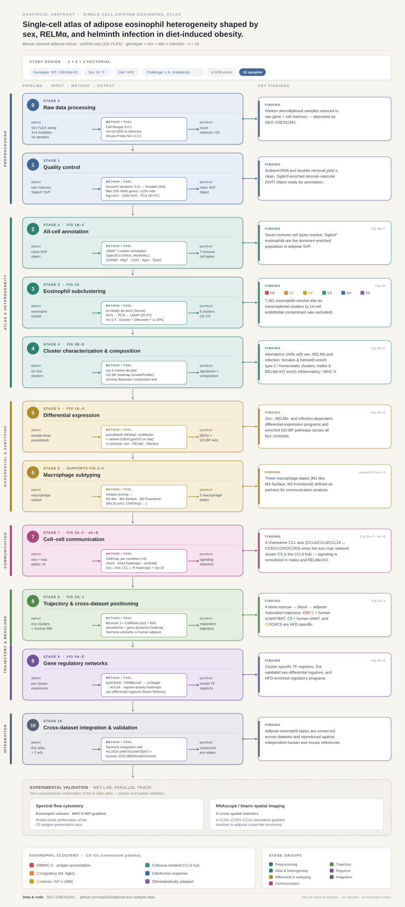

# Adipose Eosinophil and Macrophage Single-Cell Atlas

Single-cell RNA sequencing analysis of eosinophils and macrophages in adipose tissue under metabolic stress, with focus on RELMα function in obesity.

**Publication:** Ruggiero-Ruff and Qiu et al. *Single-cell heterogeneity of adipose tissue eosinophils is shaped by sex and RELMα and is linked to the macrophage communication network in obesity.* (under revision, PNAS Nexus)

## Overview

scRNA-seq characterization of eosinophil and macrophage heterogeneity in murine visceral adipose tissue across sex, RELMα genotype, and helminth infection. We identify **six transcriptionally distinct eosinophil clusters (C0–C5)** whose relative abundance shifts with these perturbations.

### Analysis Workflow



End-to-end pipeline from raw 10x FLEX reads to figures, annotated with the key finding generated at each stage. See [FIGURES.md](FIGURES.md) for the figure-to-script mapping.

### Study Design

| Factor | Conditions |
|--------|------------|
| Genotype | Wild-Type (WT), RELMα knockout (KO) |
| Sex | Male, Female |
| Diet | High-Fat Diet (HFD) |
| Challenge (females only) | HFD + *N. brasiliensis* infection |

16 samples total (4 conditions × 2–3 biological replicates), multiplexed using 10x Genomics Flex (4 samples per GEM reaction).

## Repository Structure

```
.
├── config/config.yaml          # Pipeline parameters (present but not yet wired into scripts)
├── scripts/                    # Numbered analysis scripts (00–45) — primary pipeline
│   ├── upstream_cellranger/    # Stage 0: raw reads → count matrices (Cell Ranger FLEX)
│   ├── 00_theme.R              # Shared plotting theme
│   ├── 00_decontx_per_sample.R → 45b_hif_scenic_targets.R
│   └── adhoc_*.R               # One-off / ad-hoc analyses at scripts/ root (not part of published pipeline)
├── FIGURES.md                  # Maps each published figure to its producing script
├── methods.md                  # Methods text mirroring the manuscript
├── docs/eos_atlas_workflow.svg # Pipeline schematic (rendered in README)
└── data/                       # Reference data (e.g. Hu et al. 2026)
```

## Cluster Definitions

### Eosinophil Clusters (C0–C5)
| Cluster | Enriched program | Condition enrichment |
|---------|------------------|----------------------|
| C0 | MHC-II / antigen presentation | Male, KO female |
| C1 | Migratory (Il4, Itgb2) | Female |
| C2 | Stress response (Atf6, AP-1) | Male |
| C3 | Tissue-resident, CCL6 signaling hub | All conditions |
| C4 | Infection response | Helminth-infected females |
| C5 | Metabolically adapted | Helminth-infected females |

Note: an additional small cluster (14 cells) was excluded from downstream analysis due to its low cell number.

### Macrophage Subtypes (module score classification)
- **M1-like** — *Itgax, Cd80, Tnf, Il6, Ccl2*
- **M2 Surface** — *Mrc1, Lyve1, Cd301b, Cd163*
- **M2 Functional** — *Chil3, Il10, Arg1, Tgfb1, Clec10a*

## Pipeline Summary

The pipeline runs end-to-end from raw sequencing reads. Stage 0 (raw-data processing) lives in [`scripts/upstream_cellranger/`](scripts/upstream_cellranger/); the numbered analysis scripts (`00`–`45`) begin once per-sample count matrices exist. Scripts are numbered roughly in execution order. See [FIGURES.md](FIGURES.md) for figure-to-script mapping.

| Stage | Scripts | Purpose |
|-------|---------|---------|
| Raw data processing | `upstream_cellranger/01–04` | Combine FASTQs, FastQC, `cellranger multi` (Cell Ranger 8.0.1, mm10-2020-A, FLEX Mouse Probe Set v1.0.1) demultiplexing the 4×4-multiplexed pools into per-sample count matrices |
| QC | `00_decontx_*`, `01_qc_doublet_filter`, `17_qc_supplement`, `21_ambient_rna_evidence` | DecontX, Scrublet, mitochondrial/feature filtering |
| All-cell annotation | `02_all_cells_umap`, `03_annotate_celltypes` | UMAP, marker-based annotation |
| Eosinophil subclustering | `04_eos_subcluster`, `04b_rename_clusters`, `18_clustree_resolution`, `19_batch_effect_evidence` | Resolution 0.4 selected via clustree, silhouette, Harmony sensitivity |
| Compositional analysis | `20_compositional_analysis`, `43_composition_biorep` | Bayesian (sccomp) compositional testing |
| Differential expression | `05_eos_pseudobulk`, `07c_deg_pseudobulk`, `25_fig1_revision_v3`, `27_deg_excel_export` | Pseudobulk DESeq2 with multifactor designs |
| Pathway enrichment | `08_pathway_eos_clusters`, `26_gsea_custom_butterfly` | GO BP via clusterProfiler / gseGO |
| Macrophage subtyping | `06_mac_subtype` | Module scoring (M1, M2 Surface, M2 Functional) |
| Trajectory | `11_monocle3`, `11b_monocle3_integrated`, `24_integrate_qiu_hu_gurtner`, `24b_cellrank_eos_maturation` | Monocle 3 pseudotime rooted in Gurtner bone marrow |
| Cell–cell communication | `10_cellchat`, `10b_cellchat_manuscript_figures`, `10c_cellchat_fig3d`, `33_fig3EF_cellchat_ccl_heatmap`, `44_fig3A_chord_revised` | CellChat |
| SCENIC | `14_scenic_export` → `16e_sex_diff_regulons`, `22_scenic_by_condition`, `38_scenic_auc_violin`, `41–42*_hu_regulon_*` | Per-cluster pySCENIC + cross-dataset regulon comparison |
| Cross-dataset | `12_integrate_hu`, `13_integrate_gurtner`, `23_hu_mast_marker_validation` | Harmony integration with Hu 2026 and Gurtner 2023 |

## Key Methodological Choices

- **Differential expression**: Pseudobulk DESeq2 (sample-level aggregation) for condition-level comparisons; FindAllMarkers (Wilcoxon) only for cluster-marker identification.
- **Compositional analysis**: `sccomp` (Bayesian Beta-Binomial) for cluster-proportion shifts with biological replicate variance.
- **Clustering resolution**: 0.4, selected by clustree stability + silhouette plateau + sc-SHC significance testing (see `18_clustree_resolution.R`).
- **Within-study integration**: un-integrated as primary representation (multiplexed Flex design partially confounds GEM batch with biological condition); Harmony tested as sensitivity analysis (`19_batch_effect_evidence.R`).
- **Cross-study integration**: Harmony used for cross-dataset comparison with Hu 2026 (healthy adipose depots) and Gurtner 2023 (bone marrow, blood, intestinal).

## Dependencies

### R (≥ 4.4.2)
Seurat 5.1.0 · DESeq2 · clusterProfiler · CellChat 1.6.1 · Harmony 1.2.1 · Monocle 3 1.2.9 · sccomp 1.7 · celda (DecontX) · clustree

### Python (≥ 3.10)
scanpy 1.10.3 · pyscenic · cellrank 2.0.7 · scrublet · anndata · matplotlib

## Configuration

Input/output paths are currently **hard-coded at the top of each script** to the UCR HPCC layout used for the published analysis (e.g. `BASE <- "/bigdata/nairlab/shared/XQiu/EOS_project/PNAS_revision/atlas"`, and an R library path via `.libPaths()`). To reproduce the pipeline elsewhere, edit these path assignments by hand at the head of each script you run. There is no environment-variable override.

A `config/config.yaml` is included, but it is **not yet read by any script** — it documents intended parameters only. Centralizing paths (either into `config.yaml` or a sourced `paths.R` / `paths.py`) is a known limitation and a planned cleanup.

## Data Availability

- **Raw scRNA-seq:** GEO GSE311941
- **External references:**
  - Hu et al. 2026 (healthy adipose eosinophils, eWAT/scWAT/BAT) — see `data/hu_2026/`
  - Gurtner et al. 2023 (GSE182001; bone marrow, blood, intestinal eosinophils)

## Citation

Ruggiero-Ruff RE\*, Qiu X\*, Vance L, He Y, Coss D, Godzik A⁺, Nair MG⁺. *Single-cell heterogeneity of adipose tissue eosinophils is shaped by sex and RELMα and is linked to the macrophage communication network in obesity.* 2026.

\*Equal contribution · ⁺Co-corresponding

## Contact

- Meera G Nair — meera.nair@medsch.ucr.edu
- Adam Godzik — adam.godzik@medsch.ucr.edu

Division of Biomedical Sciences, School of Medicine, University of California, Riverside
