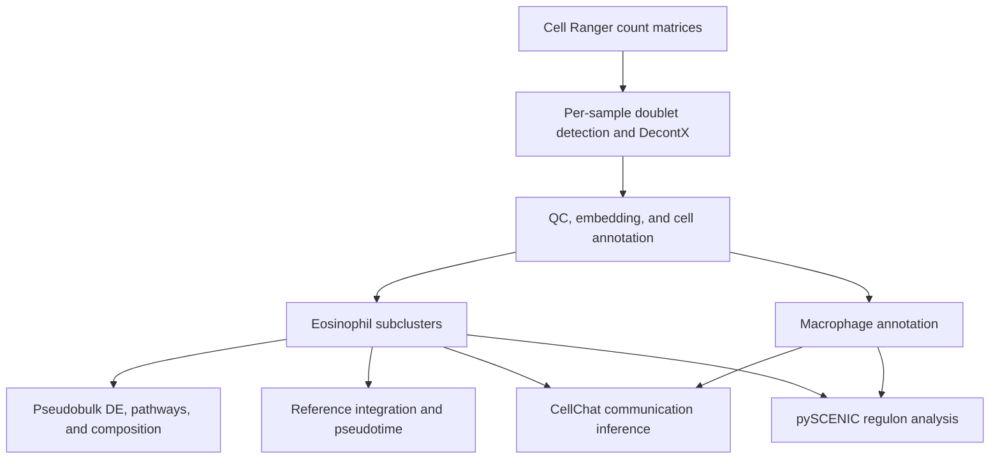

# Adipose Eosinophil Atlas

Analysis code accompanying the *PNAS Nexus* study of adipose eosinophil heterogeneity, sex, RELMα, and macrophage communication in diet-induced obesity.

**Paper:** Ruggiero-Ruff RE, Qiu X, Vance L, He Y, Coss D, Godzik A, Nair MG. **Single-cell heterogeneity of adipose eosinophils is shaped by sex and RELMα and linked to macrophage communication networks in obesity.** *PNAS Nexus*. 2026;5(11):pgag365. [Read the article](https://academic.oup.com/pnasnexus/article/5/11/pgag365/8995448) · [DOI: 10.1093/pnasnexus/pgag365](https://doi.org/10.1093/pnasnexus/pgag365)

Rebecca E. Ruggiero-Ruff and Xinru Qiu contributed equally to this work.

## Study overview

The study profiles adipose immune cells from high-fat-diet-fed mice to examine how eosinophil states vary with biological sex, RELMα deficiency, and helminth infection. It combines single-cell transcriptomics with spectral flow cytometry and in situ hybridization; this repository contains the computational analysis scripts.

| Published dataset | Scope |
|---|---|
| Immune-cell atlas | 37,334 cells spanning seven immune cell types |
| Eosinophil subcluster analysis | 7,461 eosinophils resolved into six clusters, C0–C5 |
| Experimental comparisons | Male versus female; wild type versus RELMα-deficient mice; uninfected versus helminth-infected females under HFD |
| Sequencing accession | [GSE311941](https://www.ncbi.nlm.nih.gov/geo/query/acc.cgi?acc=GSE311941), as reported in the paper's Data Availability statement |

These are the counts reported in the publication, not counts generated by a new run of this code snapshot. The immune-cell total and eosinophil subset refer to different analysis stages.

## Main findings reported in the paper

- **Eosinophil heterogeneity:** six transcriptional clusters differ in abundance across sex, RELMα status, and infection. Females and infected mice are enriched for type 2/homeostatic-associated programs, whereas males and RELMα-deficient mice show greater representation of inflammatory/MHCII-associated programs.
- **Macrophage communication:** CellChat highlights candidate eosinophil–macrophage networks, including CCL6-associated interactions and a prominent role for eosinophil cluster C3.
- **Regulatory programs:** pySCENIC identifies cluster-associated, sex-dependent, and HFD-enriched regulon activity, providing candidates for functional follow-up.

These findings are summarized from the [published study](https://doi.org/10.1093/pnasnexus/pgag365). Inferred communication, regulon coactivity, and pseudotime describe candidate relationships; they do not by themselves establish causal signaling or lineage transitions.

## From paper figures to analysis scripts

The table links the paper's analysis themes to the relevant source files. Some filenames and comments retain manuscript-revision panel labels; use the published article for final panel numbering and interpretation.

| Paper section | Related analysis | Entry points in this repository |
|---|---|---|
| Figure 1 | Immune-cell embedding and annotation; sample-level pseudobulk DE; pathway analysis | [All-cell UMAP](scripts/02_all_cells_umap.R), [annotation](scripts/03_annotate_celltypes.R), [DESeq2](scripts/07_c_deg_pseudobulk.R), [Figure 1 plotting and GSEA](scripts/25_fig1_revision_v3.R) |
| Figure 2 | Eosinophil subclusters, markers, composition, reference integration, and pseudotime | [Subclustering](scripts/04_eos_subcluster.R), [marker dot plot](scripts/31_fig2B_dotplot.R), [sccomp composition](scripts/20_compositional_analysis.R), [reference integration](scripts/24_integrate_qiu_hu_gurtner.R), [Monocle 3](scripts/11_b_monocle3_integrated.R), [pseudotime heatmap](scripts/32_fig2J_pseudotime_heatmap.R) |
| Figure 3 | Predicted eosinophil–macrophage communication and CCL networks | [Macrophage annotation](scripts/06_mac_subtype.R), [combined object](scripts/09_eos_mac_combined_umap.R), [CellChat](scripts/10_cellchat.R), [network panels](scripts/10_b_cellchat_manuscript_figures.R), [CCL heatmaps](scripts/33_fig3EF_cellchat_ccl_heatmap.R) |
| Figure 4 | Condition-specific CCL interaction plots | [CCL dot plots](scripts/34_fig4AB_ccl_dotplot.R) |
| Figure 5 | Regulon activity, coactivity networks, sex comparisons, and healthy-adipose reference comparisons | [Per-cluster pySCENIC](scripts/15_c_scenic_per_cluster.sh), [eosinophil/macrophage heatmap](scripts/16_b_scenic_eos_mac_heatmap.py), [regulon network](scripts/16_d_grn_network.py), [sex comparisons](scripts/16_e_sex_diff_regulons.py), [reference dot plot](scripts/42_h_regulon_merged_dotplot.py) |
| Supplementary analyses | QC, contamination evidence, and clustering-resolution assessment | [QC summary](scripts/17_qc_supplement.R), [ambient RNA checks](scripts/21_ambient_rna_evidence.R), [resolution assessment](scripts/18_clustree_resolution.R) |

Spectral flow cytometry and in situ hybridization provide experimental evidence in the paper. The links above cover the repository's transcriptomic analyses and associated plotting scripts.

## Computational workflow

Upstream sequencing helpers are in [scripts/upstream_cellranger](scripts/upstream_cellranger). Preprocessing starts with [per-sample doublet detection](scripts/00_a_doublet_detection_per_sample.py), [DecontX](scripts/00_decontx_per_sample.R), and [QC/merging](scripts/01_qc_doublet_filter.R). Plot styling is shared through [00_theme.R](scripts/00_theme.R).

## Data and reuse

- Obtain the study sequencing data through the paper's [GEO accession](https://www.ncbi.nlm.nih.gov/geo/query/acc.cgi?acc=GSE311941). Raw data, processed Seurat/AnnData objects, and generated results are not bundled in this repository.
- The reference-integration scripts additionally expect prepared Hu healthy-adipose and Gurtner eosinophil reference objects. See their input paths and the paper's Supplementary Methods before running those analyses.
- This is a collection of study scripts. Many scripts retain the original HPC paths, R-library settings, or SLURM configuration; adjust these and supply the required input objects for your environment. `EOS_ATLAS_BASE` is supported by selected preprocessing scripts, not by every downstream script.
- Dependencies vary by stage and include Seurat, DESeq2, sccomp, CellChat, Monocle 3, Harmony, Scrublet, DecontX, and pySCENIC. Consult the script imports and the article's Supplementary Methods for the relevant analysis environment.

For study design, experimental validation, and interpretation, refer to the [article and supplementary material](https://academic.oup.com/pnasnexus/article/5/11/pgag365/8995448). Please cite the paper above when using these analyses. Code is distributed under the [MIT license](LICENSE).
